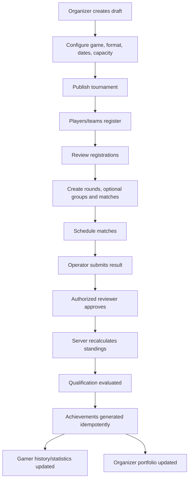
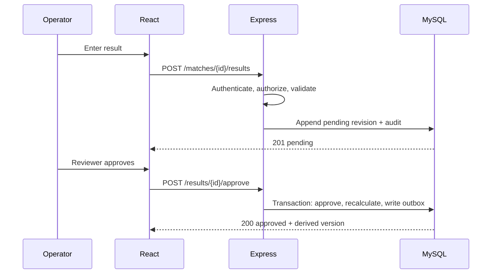

# User Journeys
## Journey index
UC-001 guest explores; UC-002 gamer registers; UC-003 gamer creates profile; UC-004 creates team; UC-005 invites/joins team; UC-006 discovers tournament; UC-007 registers; UC-008 organizer onboarding; UC-009 organization creation; UC-010 tournament creation/configuration; UC-011 rounds/groups; UC-012 scheduling; UC-013 result submission; UC-014 result approval; UC-015 standings; UC-016 qualification; UC-017 achievement generation; UC-018 gamer profile update; UC-019 organizer portfolio update; UC-020 profile discovery; UC-021 admin moderation.

## End-to-end event-to-identity flow

## Result approval sequence

## Workflow details
| Journey | Starting condition/actions | System/API/DB | Validation/failure/edge cases |
|---|---|---|---|
| UC-001 Guest | No session; browse public pages | GET tournaments/profiles; read-only | Only published/public data; unknown slug 404 |
| UC-002 Registration | Submit email/password | POST `/auth/register`; User + token | Duplicate email, weak password, expired token; generic reset response |
| UC-003 Profile | Auth user edits IGN, games, roles, bio, links | PATCH `/me/gamer-profile`; GamerProfile/GamerGame | Slug collision, invalid links, visibility restrictions |
| UC-004 Team | Gamer creates team | POST `/teams`; Team + captain membership | Unique slug/name policy; creator captain |
| UC-005 Invitation | Captain invites; invitee accepts | POST invite/accept; TeamInvitation + TeamMembership | Expired/revoked/replayed token; roster capacity policy open |
| UC-006 Discovery | Published event exists | GET `/tournaments`; public read | Registration closed/full; filters allowlisted |
| UC-007 Registration | Eligible gamer/captain registers | POST `/tournaments/:id/registrations`; Registration + roster snapshot | Duplicate, capacity race, closed window, ineligible roster |
| UC-008 Organizer | User creates individual profile | POST organizer profile; OrganizerProfile | Slug collision; verification remains unverified |
| UC-009 Organization | User creates org | POST `/organizations`; Organization + owner membership | Unique slug; ownership transfer policy open |
| UC-010 Tournament | Authorized organizer creates draft/configures | POST/PATCH tournaments; Tournament + ScoringConfig | Date order, supported game/format, lock after entries |
| UC-011 Structure | Admin creates rounds/groups | POST rounds/groups | Group optional; sequence uniqueness; progression valid |
| UC-012 Scheduling | Admin schedules matches | POST/PATCH matches | Tournament timezone, participants registered; overlap policy open |
| UC-013 Submit result | Authorized operator submits | POST match results; ResultRevision + AuditLog | Schema, participant IDs, match state |
| UC-014 Approve | Reviewer approves/rejects | POST approve/reject; transaction | Permission, separation of duties, concurrent approval |
| UC-015 Standings | Approved result exists | Server calculates StandingSnapshot/Rows | Pending results excluded; deterministic rebuild |
| UC-016 Qualification | Source standings ready | Qualification service/API | Top-N scope and tie policy must be approved |
| UC-017 Achievement | Approved result triggers rule | Achievement service/outbox | Idempotency; corrections reconcile, history retained |
| UC-018 Gamer update | Gamer views profile | Derived history/stats read | Only approved records count |
| UC-019 Portfolio | Tournament completed | OrganizerPortfolioRecord generated | Source tournament linked; no duplicate |
| UC-020 Discovery | Public search request | GET profile endpoints | Search/filter depth is an open V1 scope question |
| UC-021 Moderation | Admin reviews content/account | Admin API; ModerationAction + AuditLog | Platform-admin only; reason required; appeal policy open |
