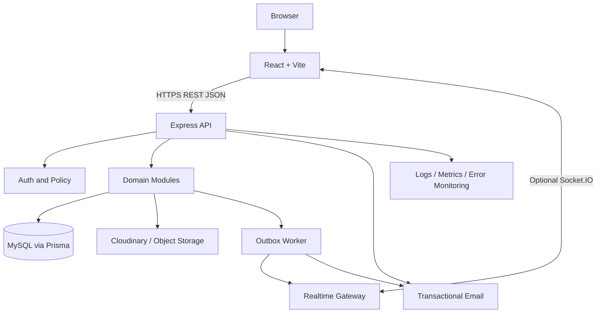
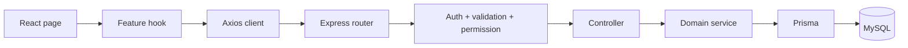
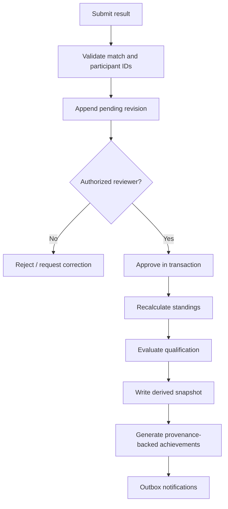
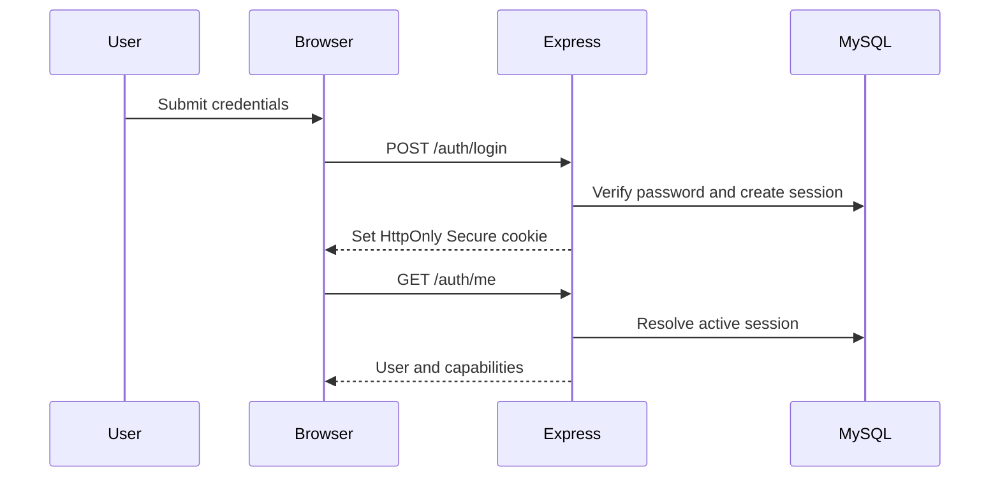

# System Architecture
## Decision
V1 uses a modular monolith: one React SPA, one Express application, one MySQL database, explicit domain modules. This supports transaction-heavy workflows without premature distributed systems.

## Backend modules
Auth; Users; Gamer; Organizer; Organizations; Teams; Games; Tournaments; Registrations; Competition (rounds/groups/matches); Scoring; Results; Standings; Qualifications; Achievements; Portfolios; Trust; Announcements; Notifications; Media; Admin; Analytics.

## Request flow

## Result pipeline

## Authentication sequence

## Architecture rules
Modules own their tables and service interfaces. Cross-module writes use services/application orchestration, not arbitrary table mutation. Results/standings/achievements are derived from authoritative approved records. Async email/socket delivery uses a durable outbox. Provider failures do not roll back an approved result.
