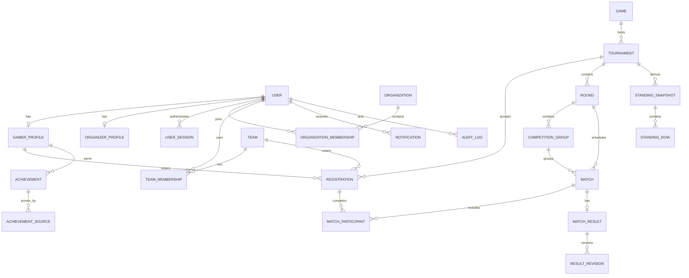

# Logical ER Diagram

Tournament owner must be exactly one of individual organizer or organization. Registration must be exactly one team or individual gamer; choose typed nullable FKs with DB check or a `TournamentEntrant` supertype before schema freeze. Match participants reference registration, not arbitrary user IDs.
