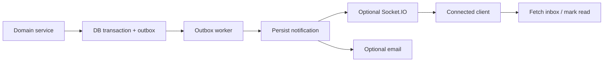

# Notifications and Real-Time System
## V1 scope
Persisted in-app notifications for tournament events and announcements. Direct messaging and expanded community communication are V2. Real-time updates are mentioned in tournament communication; Socket.IO is optional delivery, not the source of truth.

| Event | Recipients | V1 delivery |
|---|---|---|
| Registration approved/rejected | Entrant/captain | In-app |
| Team invitation | Invitee | In-app; email proposal |
| Match schedule changed | Match participants | In-app |
| Result submitted/approved/rejected/corrected | Entrants/operators | In-app |
| Qualification updated | Affected entrants | In-app |
| Announcement published | Registered participants | In-app |
| Achievement generated/updated | Gamer | In-app |
| Organization invitation | Invitee | In-app; email proposal |

Persist event/outbox first; create notification with unique dedupe key; emit socket event best-effort. On reconnect, client fetches inbox. Retry with bounded exponential backoff; dead-letter failures. Never include room credentials or sensitive personal data in payload. Socket authorization validates session and user room. No V1 direct messaging.
